# UFROSafe

**A user-centred design proposal for reporting near misses and unsafe conditions at Universidad de La Frontera (UFRO).**

UFROSafe is a mobile-first concept that helps students, staff, and faculty report hazards quickly, understand their privacy choices, and receive confirmation after submitting a report. Its purpose is prevention: making it easier to raise a risk before it causes an accident.

> This repository documents a UXD/HCI design project. It describes a design proposal and its supporting artifacts; it is not documentation for a deployed reporting service.

## Contents

- [Problem and proposal](#problem-and-proposal)
- [Product scope](#product-scope)
- [UX design process](#ux-design-process)
  - [Strategy](#1-strategy)
  - [Scope: personas, benchmark, and customer journey](#2-scope-ux-personas-benchmark-and-customer-journey)
  - [Structure: navigation flow](#3-structure-navigation-flow)
  - [Skeleton: low-fidelity design](#4-skeleton-low-fidelity-design)
  - [Surface: high-fidelity interfaces](#5-surface-high-fidelity-interfaces)
- [Usability, accessibility, and iteration](#usability-accessibility-and-iteration)
- [AI usage log](#ai-usage-log)
- [Project context](#project-context)

## Problem and proposal

Hazards and near misses can go unreported when reporting is difficult, takes too long, or leaves people unsure about privacy and what happens next. An unreported unsafe condition may remain and later cause injury or damage. UFROSafe addresses these barriers with a short reporting experience, clear privacy choices, and feedback after submission.

The proposal is guided by three principles:

- **Speed:** make the primary reporting action easy to find and reduce unnecessary steps and typing.
- **Privacy:** explain anonymous and identified reporting before asking for sensitive information.
- **Trust:** confirm receipt and provide a way to follow up on a report.

UFROSafe is intended for preventive reporting. It does not replace official emergency channels, provide medical advice, assign responsibility, or guarantee that a submitted hazard will be resolved immediately.

## Product scope

The design is deliberately centred on one primary flow and two secondary flows, consistent with the course requirement to keep the solution focused.

| Priority | Flow | Purpose |
| --- | --- | --- |
| **Primary** | Submit a near-miss or unsafe-condition report | Record the essential details with minimal effort and clear privacy choices. |
| Secondary | Track a submitted report | Check confirmation or status, including through a tracking code where available. |
| Secondary | View reported campus risks | Support preventive awareness through aggregated risk locations, without exposing reporters. |

### Primary reporting flow

```text
Detect a risk
  → Start a report
  → Confirm that it is a near miss / unsafe condition, not an emergency
  → Choose anonymous or identified reporting
  → Provide location and risk category
  → Add a short description and optional photo
  → Review and submit
  → Receive confirmation and a way to track the report
```

Account management, administrative case handling, emergency response, medical diagnosis, and disciplinary processes are outside the initial design scope.

## UX design process

The project is organized around the UX planes—**Strategy, Scope, Structure, Skeleton, and Surface**—to connect user needs with the proposed experience.

### 1. Strategy

The Value Proposition Canvas captures the relationship between the campus community’s reporting needs and the proposed value of UFROSafe: quick reporting, reduced effort, and privacy-aware participation.

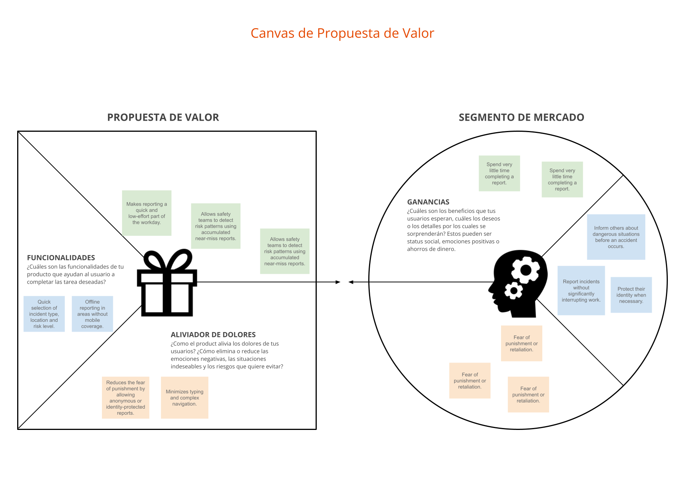

### 2. Scope: UX personas, benchmark, and customer journey

The project considers three community profiles: a student, a university infrastructure administrator, and an academic. Their goals and frustrations highlight the need for a fast, understandable way to report hazards, with location, category, confirmation, and follow-up support.

| Persona | Project asset |
| --- | --- |
| Student | 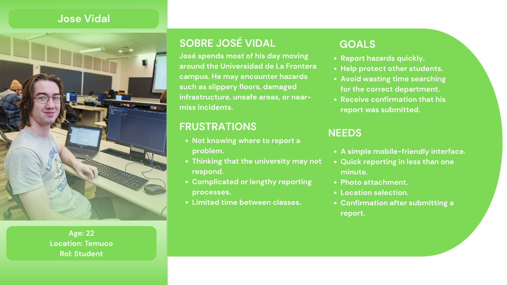 |
| UFRO infrastructure administrator | 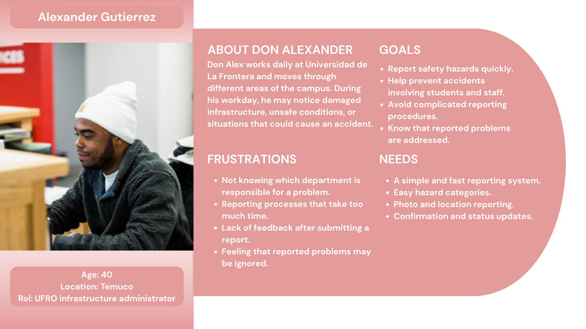 |
| Academic | 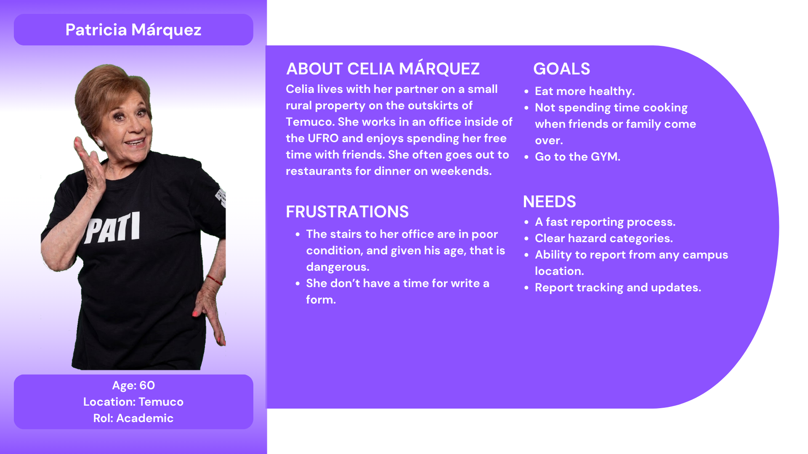 |

These personas represent members of the UFRO community who may encounter or manage campus hazards.

#### Benchmark

The benchmark compares UFROSafe with SafeZone, Vector LiveSafe, SOSAFE, and SafetyCulture. Its synthesis organizes proposed actions into four groups: **strengthen**, **include**, **reduce**, and **eliminate**. It highlights ideas such as configurable anonymity, location and photo evidence, anonymous tracking, campus risk mapping, and avoiding mandatory registration and distracting social features.

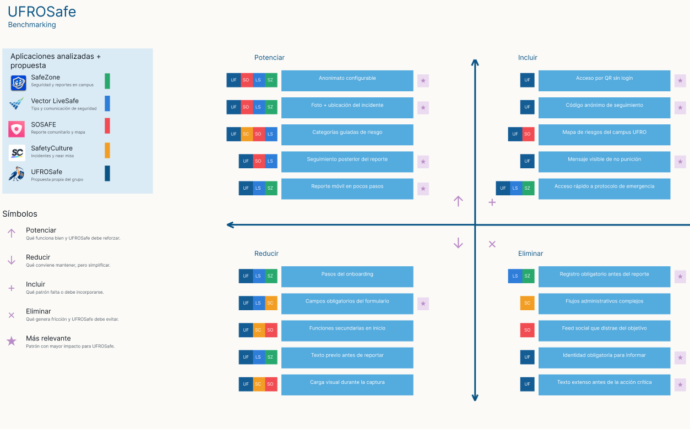

This image presents the benchmark synthesis and competitor references.

#### Customer Journey Map

The journey follows the experience from noticing a risk through deciding to report, choosing privacy, submitting the report, and checking its result. It highlights fear of identification as a critical moment and maps opportunities such as explaining non-punitive reporting, offering anonymous reporting, minimizing fields, and providing a tracking code.

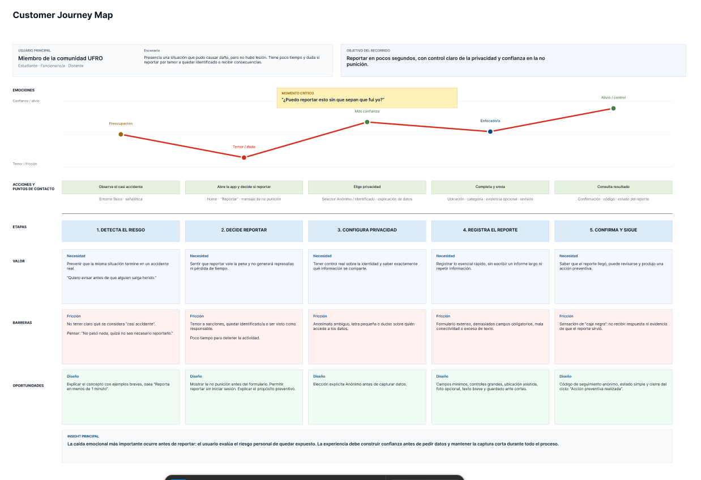

### 3. Structure: navigation flow

The diagram below is a **navigation flow / information-architecture diagram**. It corresponds to the rubric’s *navigation flow* and *complete diagram* deliverables under the Structure plane; it is not a system architecture or data-flow diagram. It shows the home sections and screen-level paths for reporting a near miss, viewing the risk map, tracking a report, account, and information.

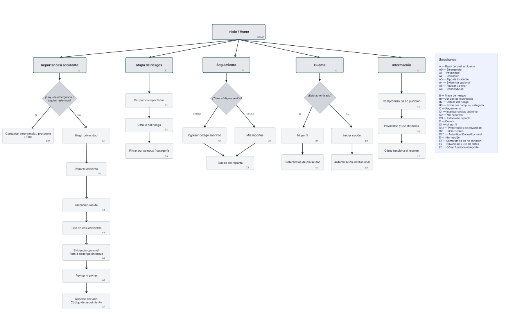

### 4. Skeleton: low-fidelity design

Six photographed paper wireframes are available. Together they document low-fidelity screens for the report list/history, risk map, report form, and report details/status.

<details>
<summary>View the six low-fidelity wireframes</summary>

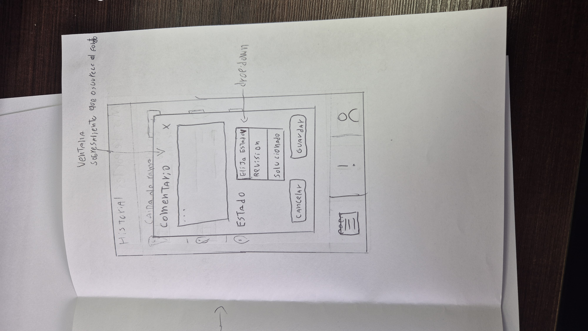

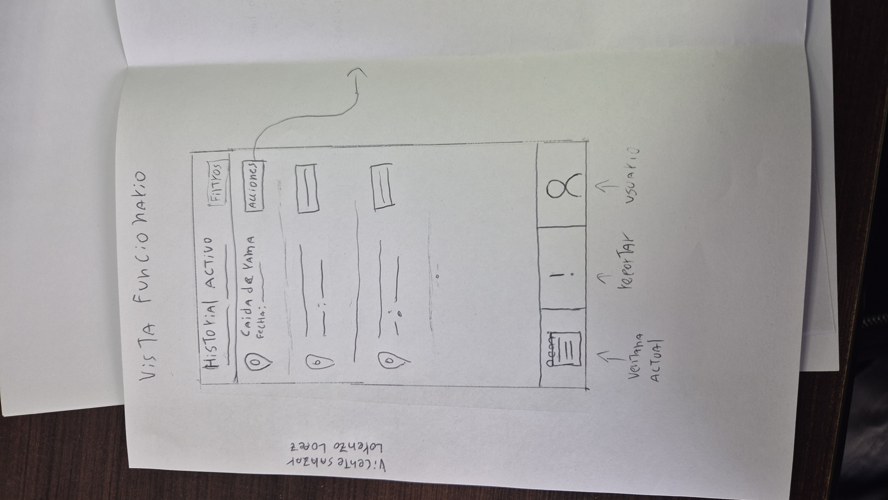

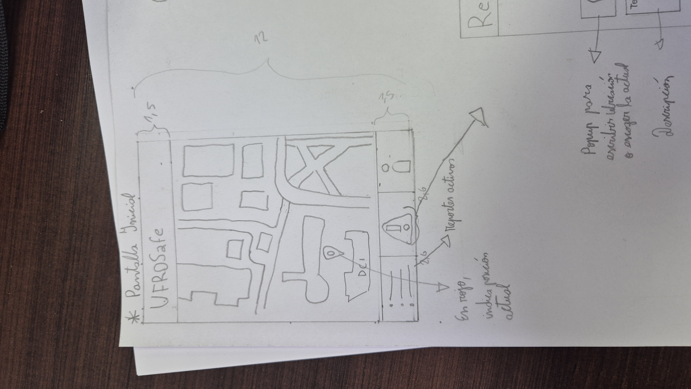

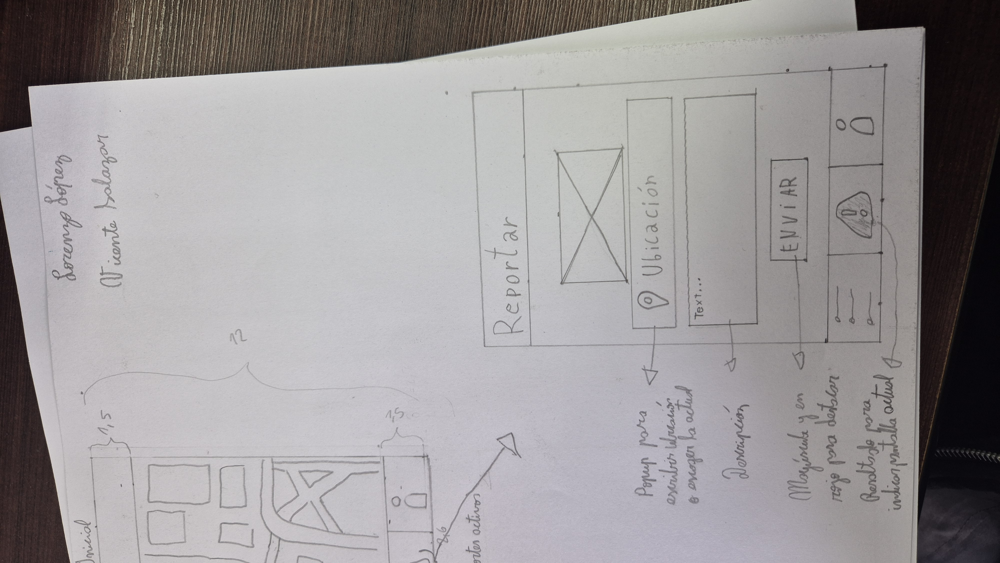

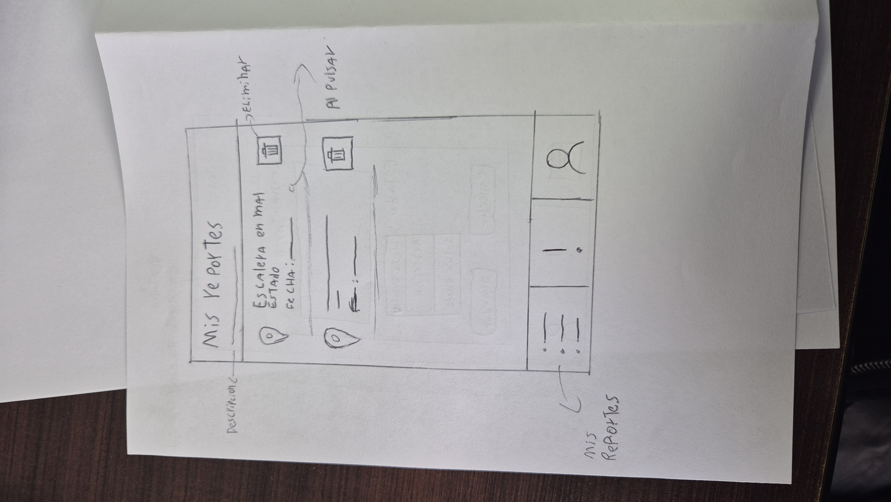

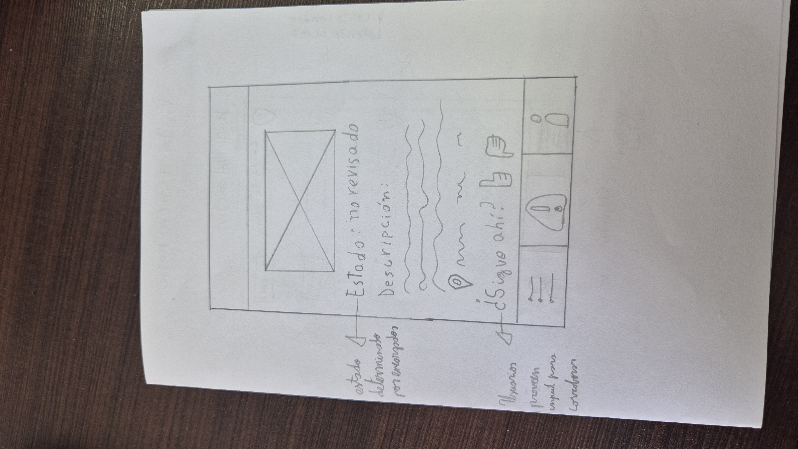

</details>

The sketches show early screen concepts for the main reporting and follow-up experience.

### 5. Surface: high-fidelity interfaces


## Usability, accessibility, and iteration

The interface should prioritize readable text, sufficient contrast, accessible touch targets, clear visual hierarchy, low cognitive load, and one-handed mobile use where practical. Privacy choices should be explained before report details are requested. Emergency situations should be directed to the appropriate official channel.

## AI usage log

This README was drafted with generative-AI assistance from OpenAI using the project context, rubric, examples, and assets supplied for this task.

| Artifact | Tool and assistance | Documented decisions |
| --- | --- | --- |
| `README.md` | OpenAI; instruction: create an English README following the supplied rubric, project context, examples, and assets. | 1. Used English to meet the repository language requirement. 2. Kept the primary report flow and no more than two secondary flows, based on the supplied project context. 3. Linked the supplied local assets and preserved the existing hosted project visuals. |

This entry concerns README drafting; it does not claim AI assistance for research, personas, the canvas, flows, low-fidelity work, or high-fidelity interfaces.

## Project context

The project is developed for the User Experience Design and Human-Computer Interaction (UXD/HCI) coursework at Universidad de La Frontera. The assets below are the project visuals currently stored in the repository.

### Local assets

| File | Description |
| --- | --- |
| [`assets/Values_Canvas.png`](./assets/Values_Canvas.png) | UFROSafe Value Proposition Canvas. |
| [`assets/UserUX-1.png`](./assets/UserUX-1.png) | Student UX persona. |
| [`assets/UserUX-2.png`](./assets/UserUX-2.png) | Infrastructure administrator UX persona. |
| [`assets/UserUX-3.png`](./assets/UserUX-3.png) | Academic UX persona. |
| [`assets/Benchmark.png`](./assets/Benchmark.png) | Competitor benchmark and feature synthesis. |
| [`assets/Diagrama.png`](./assets/Diagrama.png) | Navigation flow / information-architecture diagram. |
| [`assets/Customer_Journey_Map.png`](./assets/Customer_Journey_Map.png) | Customer Journey Map. |
| [`assets/Lowfi_wireframe1.jpg`](./assets/Lowfi_wireframe1.jpg) – [`Lowfi_wireframe6.jpg`](./assets/Lowfi_wireframe6.jpg) | Six photographed low-fidelity paper wireframes. |
